# Enterprise Azure SOC Lab

> Azure-hosted enterprise security operations lab integrating Active Directory, Wazuh SIEM, endpoint telemetry, threat hunting, Python reporting, Shuffle SOAR, threat-intelligence enrichment, analyst approval, and response validation.

<p align="center">
  
</p>

## Overview

This project models a small enterprise Security Operations Center in Microsoft Azure. It combines Windows and Linux infrastructure with centralized log collection, detection, investigation, reporting, and response workflows.

The lab was built to demonstrate practical skills across:

- Azure infrastructure and network administration
- Active Directory Domain Services and Group Policy
- Windows and Linux security telemetry
- Wazuh SIEM deployment, monitoring, and threat hunting
- Detection engineering and MITRE ATT&CK context
- Python-based alert parsing and reporting
- Shuffle SOAR orchestration
- VirusTotal and AbuseIPDB enrichment
- Slack and email-based analyst notification
- Human-in-the-loop response approval
- Azure Automation and endpoint-side response validation

This repository intentionally distinguishes between controls that were fully validated, controls validated at the component level, and experiments that exposed telemetry or automation gaps.

## Key Outcomes

- Deployed three Azure virtual machines inside an isolated lab network: a domain controller, a Windows 11 endpoint, and an Ubuntu-based Wazuh server.
- Joined the Windows endpoint to the `enterprise.local` domain and applied password, lockout, access, and Remote Desktop policies.
- Centralized Windows Security, Sysmon, PowerShell, File Integrity Monitoring, SSH, Auditd, and Linux telemetry in Wazuh.
- Detected and investigated repeated Windows authentication failures, suspicious process activity, privileged logons, SSH brute-force activity, file changes, vulnerabilities, and CIS configuration findings.
- Correlated individual Windows failed-logon alerts into Wazuh rule `60204` — **Multiple Windows Logon Failures**.
- Generated structured TXT, JSON, and CSV alert reports from Wazuh `alerts.json`; the committed sample processed **482 alerts**, including **23 High**, **260 Medium**, and **199 Low** severity records.
- Routed structured incident data into Shuffle for triage, threat enrichment, P1 escalation, notification, and analyst approval.
- Validated non-destructive Wazuh Active Response execution and retained separate evidence for Azure Automation and Windows Firewall response testing.

## Architecture

### Azure Infrastructure

<p align="center">
  
</p>

| System | Platform | Role | Private IP |
|---|---|---|---|
| `dc01` | Windows Server 2025 | Active Directory Domain Services, DNS, Group Policy, Wazuh agent | `10.0.0.4` |
| `win11` | Windows 11 Pro | Domain-joined endpoint, Sysmon, PowerShell logging, Wazuh agent | `10.0.0.5` |
| `wazuh01` | Ubuntu Server | Wazuh Manager, Indexer, Dashboard, Linux telemetry, Python tooling | `10.0.0.6` |

The systems reside in the `enterprise-soc-rg` resource group and `enterprise-soc-vnet` (`10.0.0.0/16`). Network Security Groups and host firewalls control management and telemetry traffic.

### Active Directory

<p align="center">
  
</p>

The domain contains departmental and resource OUs, role-based security groups, domain users, a domain-joined workstation, and a disposable service account used for response testing.

Implemented controls include:

- Password and account-lockout policies
- Departmental and privileged security groups
- Group Policy configuration
- DNS-based domain resolution
- Domain-joined endpoint authentication
- Least-privilege Remote Desktop access validation

<p align="center">
  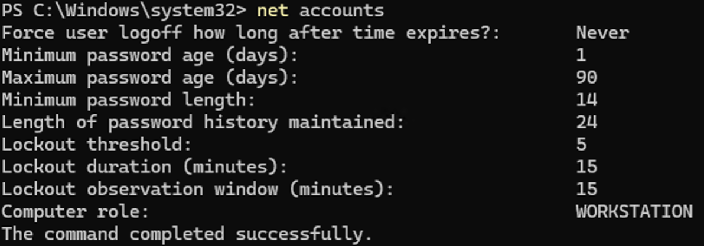
</p>

<p align="center"><em>Effective domain password and account-lockout settings verified from the Windows environment.</em></p>

### SIEM and SOAR Data Flow

<p align="center">
  
</p>

```text
Windows and Linux telemetry
          ↓
Wazuh agents and local collectors
          ↓
Wazuh Manager → Indexer → Dashboard
          ↓
Detection, correlation, MITRE context, and investigation
          ↓
Python alert parsing and structured case data
          ↓
Shuffle webhook
          ↓
VirusTotal / AbuseIPDB enrichment
          ↓
Slack and email notification
          ↓
Human approval
          ↓
Response workflow and validation
```

## Technologies

| Area | Technologies |
|---|---|
| Cloud | Microsoft Azure, Virtual Machines, Virtual Network, Subnet, NSG, Azure Automation |
| Identity | Active Directory Domain Services, DNS, Group Policy, PowerShell |
| SIEM | Wazuh Manager, Indexer, Dashboard, agents, rules, decoders, Active Response |
| Endpoint telemetry | Windows Security logs, Sysmon, PowerShell logging, Windows Defender, FIM |
| Linux telemetry | Auditd, SSH authentication logs, UFW, Linux FIM |
| SOAR | Shuffle, webhooks, conditional routing, analyst approval |
| Threat intelligence | VirusTotal, AbuseIPDB |
| Notifications | Slack, email |
| Automation | Python 3, PowerShell, Bash, JSON, CSV |
| Adversary emulation | Atomic Red Team, controlled authentication and endpoint tests |
| Frameworks | MITRE ATT&CK, CIS benchmarks |

## Implementation

### 1. Azure and Enterprise Infrastructure

The lab began with Azure networking and three virtual machines. Static private addressing and DNS enabled communication between the domain controller, endpoint, and Wazuh server.

Host-level firewall troubleshooting was a significant part of the build. Azure NSG rules alone were insufficient: Ubuntu UFW also had to permit HTTPS and Wazuh agent traffic.

```bash
sudo ufw allow 443/tcp
sudo ufw allow 1514/tcp
sudo ufw allow 1515/tcp
sudo ufw status verbose
```

Connectivity was validated from Windows with:

```powershell
Test-NetConnection 10.0.0.6 -Port 1514
Test-NetConnection 10.0.0.6 -Port 1515
```

### 2. Active Directory and Windows Client

`dc01` was promoted to a domain controller for `enterprise.local`. Organizational Units, users, security groups, password controls, account-lockout controls, and Group Policy settings were configured.

The Windows 11 endpoint was configured to use domain DNS and successfully joined to the domain.

<p align="center">
  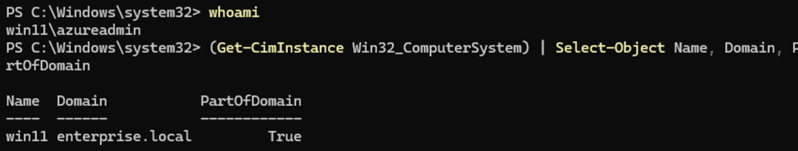
</p>

<p align="center"><em>Windows 11 successfully joined to the enterprise domain.</em></p>

### 3. Endpoint and Linux Telemetry

The Windows endpoint supplied:

- Windows Security events
- Sysmon process telemetry
- PowerShell activity
- File Integrity Monitoring events
- Wazuh agent health data

The Ubuntu host supplied:

- SSH authentication logs
- Auditd events
- Local Linux FIM
- Wazuh server and Active Response logs

<p align="center">
  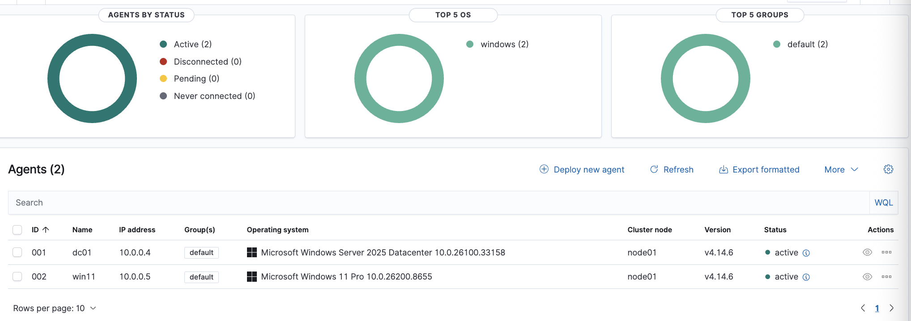
</p>

<p align="center"><em>Centralized visibility for the Windows Server and Windows 11 agents.</em></p>

### 4. Security Posture Monitoring

#### File Integrity Monitoring

Wazuh captured file-added, file-modified, and file-deleted activity across monitored systems.

<p align="center">
  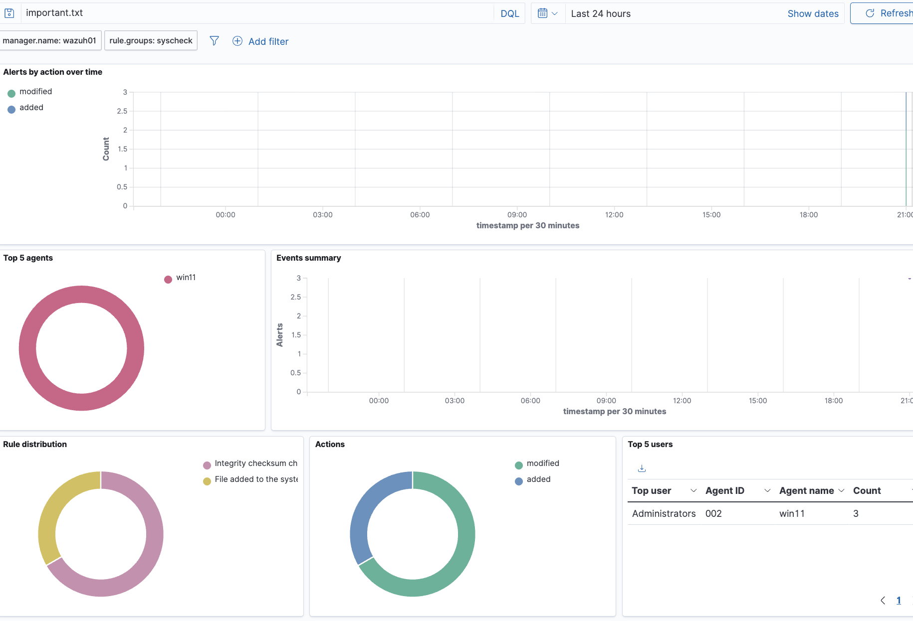
</p>

#### Vulnerability Detection

The Windows vulnerability inventory exposed affected packages, CVE identifiers, and severity. A captured validation view showed seven findings: five High and two Medium.

<p align="center">
  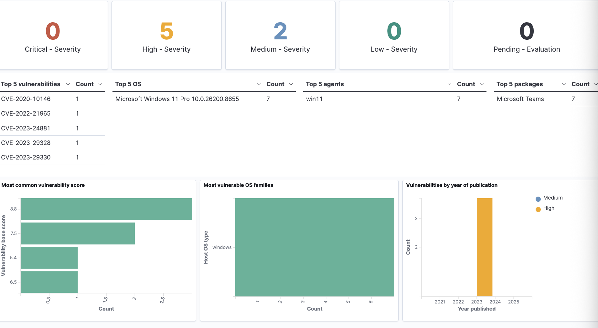
</p>

#### Security Configuration Assessment

Wazuh SCA evaluated CIS benchmark controls for Windows and Ubuntu and displayed passed, failed, and not-applicable checks.

<p align="center">
  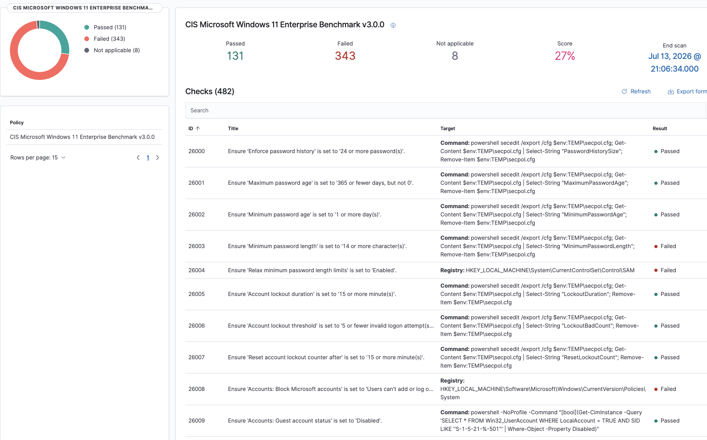
</p>

## Detection Engineering and Threat Hunting

### Authentication Failure Correlation

Controlled failed-authentication activity generated Windows Event ID `4625` and Wazuh rule `60122`. Repeated events were correlated into rule `60204`, a Level 10 **Multiple Windows Logon Failures** alert mapped to brute-force behavior.

<p align="center">
  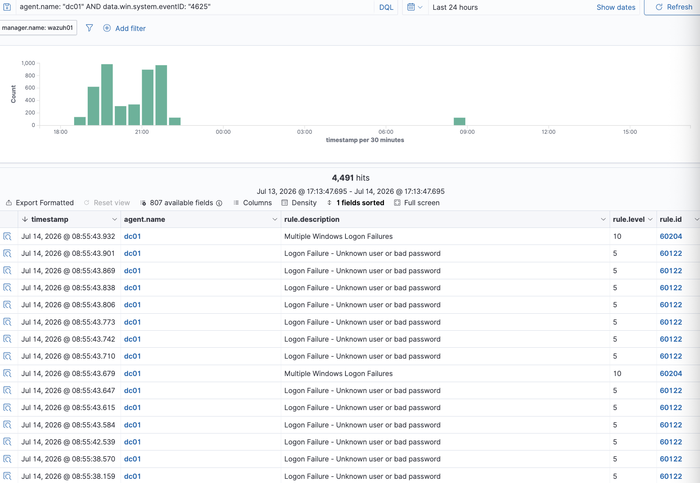
</p>

<p align="center"><em>Individual failed logons and correlated multiple-failure alerts shown together.</em></p>

A separate Python timeline reconstructed the progression from base alerts to the higher-severity correlated rule.

<p align="center">
  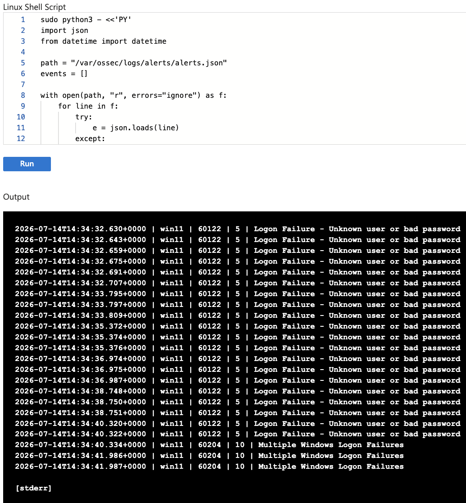
</p>

### Sysmon Process Telemetry

Sysmon Event ID `1` supplied process image, command line, parent process, user context, and hash data. Wazuh surfaced suspicious command-shell, discovery, and PowerShell behavior.

<p align="center">
  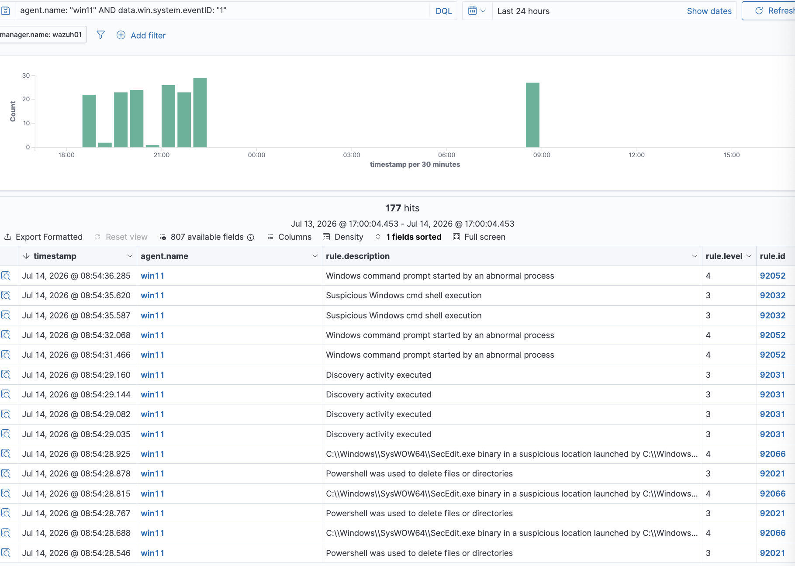
</p>

### Privileged Logon Visibility

Windows Event ID `4672` was collected and displayed as **Special privileges assigned to new logon**. This is treated as privileged-session telemetry—not automatic proof of malicious privilege escalation.

### Linux SSH Detection

Controlled SSH authentication failures were detected and mapped to MITRE ATT&CK technique `T1110` where supported by Wazuh rule metadata.

### Detection Coverage

| Activity | Primary evidence | Detection context |
|---|---|---|
| Failed Windows logon | Event ID `4625`, rules `60122` and `60204` | Credential-access / brute-force investigation |
| Successful Windows logon | Event ID `4624`, rule `60106` | Authentication and access review |
| Privileged logon | Event ID `4672`, rule `67028` | Privileged-session investigation |
| Suspicious PowerShell/process activity | Sysmon Event ID `1`, rules including `92021` and `92066` | Command execution and process analysis |
| SSH brute force | Wazuh rule `5712` | MITRE ATT&CK `T1110` |
| File added, changed, or deleted | FIM rules `550`, `553`, and `554` | Integrity monitoring |
| Vulnerable software | Wazuh vulnerability inventory | CVE and package review |
| CIS configuration findings | Wazuh SCA | Security posture and hardening |

### Custom Rule Engineering

A custom PowerShell rule (`100100`) was created and loaded while troubleshooting Wazuh parent rules, decoded fields, Sysmon EventChannel collection, and raw archives.

The rule was **not** proven end to end during the recorded validation window. The exercise is therefore documented as rule-development and telemetry-pipeline troubleshooting rather than a successful production detection.

## Adversary Emulation

Atomic Red Team was installed on `win11`, and the PowerShell Command Execution test `T1059.001-17` completed with exit code `0`.

Wazuh Threat Hunting was then used to inspect resulting process telemetry, including command line, parent process, process identifiers, hashes, and execution context.

<p align="center">
  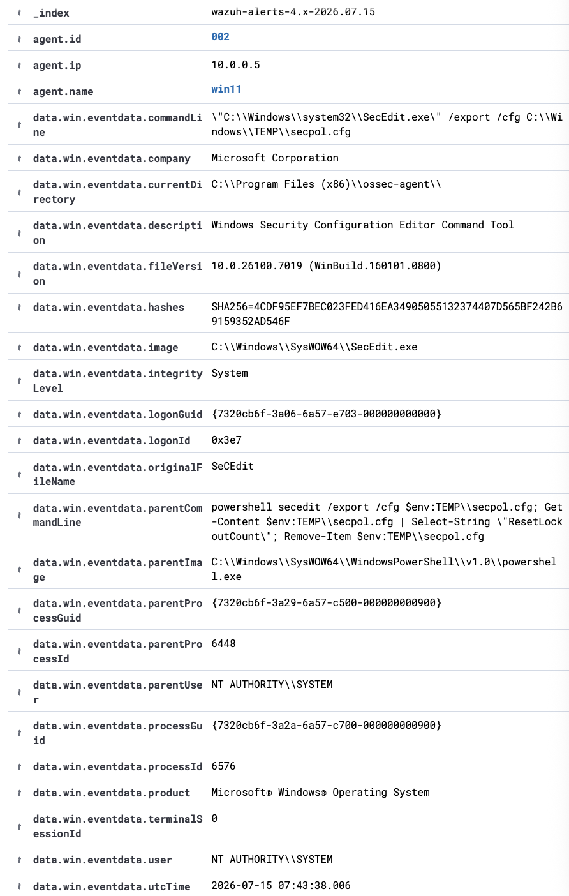
</p>

<p align="center"><em>Detailed process telemetry captured after controlled PowerShell adversary emulation.</em></p>

The exact event is not presented as automatically MITRE-mapped unless that mapping is visible in the rule metadata.

## Active Response

A safe server-side Wazuh Active Response command was attached to rule `60204`. The script wrote timestamped `SAFE_ACTIVE_RESPONSE_TRIGGERED` entries to `active-responses.log`, proving rule-triggered execution without performing a destructive action.

<p align="center">
  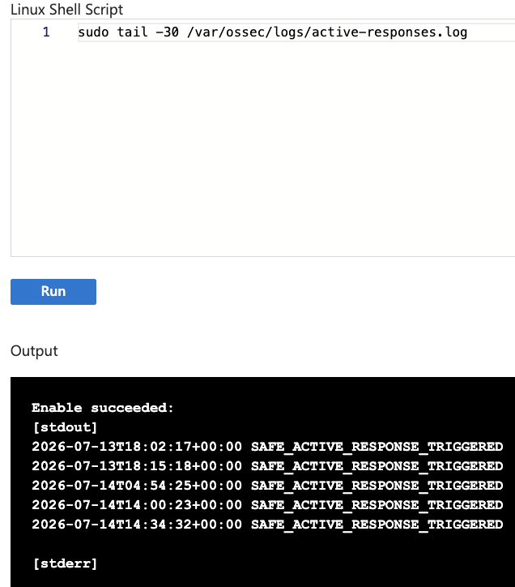
</p>

<p align="center"><em>Non-destructive proof that the Wazuh Active Response workflow executed.</em></p>

This validation is intentionally separate from later Windows Firewall and Active Directory containment experiments.

## Python Automation

The repository includes a modular Python toolkit under [`python/`](python/).

### Alert Report Generator

[`python/alert_report.py`](python/alert_report.py) is the strongest end-to-end utility in the repository. It:

- Reads Wazuh `/var/ossec/logs/alerts/alerts.json`
- Handles missing files, permission failures, and malformed JSON lines
- Normalizes alert, agent, source-IP, user, and MITRE fields
- Assigns severity from Wazuh rule level
- Aggregates top rules, agents, source IPs, and ATT&CK techniques
- Writes TXT, JSON, and CSV reports

```bash
cd python

python3 alert_report.py \
  --input /var/ossec/logs/alerts/alerts.json \
  --output-dir reports \
  --limit 1000
```

<p align="center">
  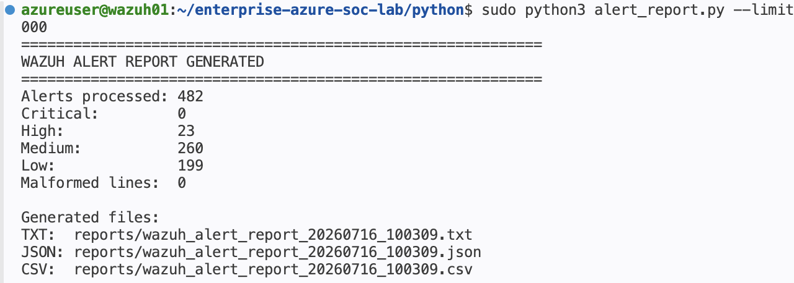
</p>

The committed sample report processed:

```text
Total alerts: 482
Critical:       0
High:          23
Medium:       260
Low:          199
```

### Supporting Utilities

| Script | Purpose | Current maturity |
|---|---|---|
| [`alert_report.py`](python/alert_report.py) | Parse and export Wazuh alert records | Dynamic, data-driven |
| [`daily_health.py`](python/daily_health.py) | Count available alerts and write a daily summary | Dynamic alert count |
| [`log_parser.py`](python/log_parser.py) | Extract recent Wazuh log data into a report | Lab utility |
| [`agent_status.py`](python/agent_status.py) | Produce an agent-status report | Static status template |
| [`alert_statistics.py`](python/alert_statistics.py) | Produce a severity-distribution summary | Partially hard-coded sample values |
| [`soc_health_check.py`](python/soc_health_check.py) | Produce a SOC health summary | Alert count plus static status fields |
| [`incident_report.py`](python/incident_report.py) | Generate an incident-report template | Reporting prototype |
| [`dashboard_export.py`](python/dashboard_export.py) | Document expected dashboard coverage | Reporting prototype |
| [`ioc_lookup.py`](python/ioc_lookup.py) | Produce an IOC lookup report | API lookup not configured |
| [`threat_client.py`](python/threat_client.py) | Report threat-intelligence integration readiness | API clients not configured |
| [`soc_summary.py`](python/soc_summary.py) | Produce a consolidated SOC summary | Lab summary utility |

The Python threat-intelligence scripts should not be confused with the working VirusTotal and AbuseIPDB enrichment demonstrated inside Shuffle.

## Shuffle SOAR Automation

<p align="center">
  
</p>

The `Enterprise Wazuh SOC Response` workflow received structured incident JSON through the `Wazuh Alert Ingestion` webhook.

Key fields included:

```text
case_id
incident_id
case_status
severity
priority
assigned_queue
response_sla
affected_endpoint
primary_target_account
failed_logon_count
source_ip
assessment
analyst_actions
created_utc
```

The workflow implemented:

1. Webhook ingestion
2. JSON parsing and SOC triage
3. HIGH/P1 conditional routing
4. VirusTotal hash enrichment
5. AbuseIPDB source-IP enrichment
6. Slack and email notification
7. Human approval before response
8. Azure Automation response experiments

### Threat-Intelligence Enrichment

<p align="center">
  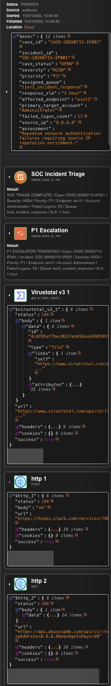
</p>

<p align="center"><em>VirusTotal and AbuseIPDB actions executed as part of incident enrichment.</em></p>

### P1 Notification

<p align="center">
  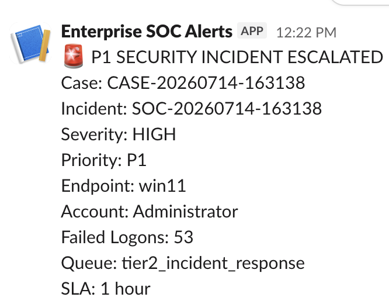
</p>

The Slack alert included the case ID, incident ID, severity, priority, endpoint, targeted account, failed-logon count, assigned queue, and SLA.

### Human Approval

<p align="center">
  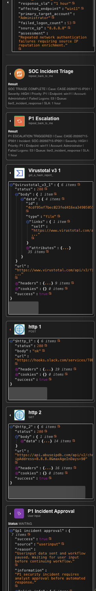
</p>

<p align="center"><em>The workflow paused at a WAITING state before a potentially destructive response.</em></p>

This control prevented enrichment or notification success from being mistaken for authorization to contain an endpoint or disable an account.

## Response Validation

Azure Automation, a Hybrid Runbook Worker, PowerShell runbooks, and endpoint-side commands were used to test response execution.

The repository contains evidence for:

- A Hybrid Worker job reaching a completed state
- An Azure Automation firewall-block job reporting success
- A Windows Firewall rule displayed as enabled with an inbound block action and a target remote address

<p align="center">
  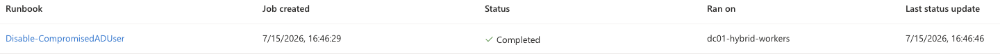
</p>

<p align="center">
  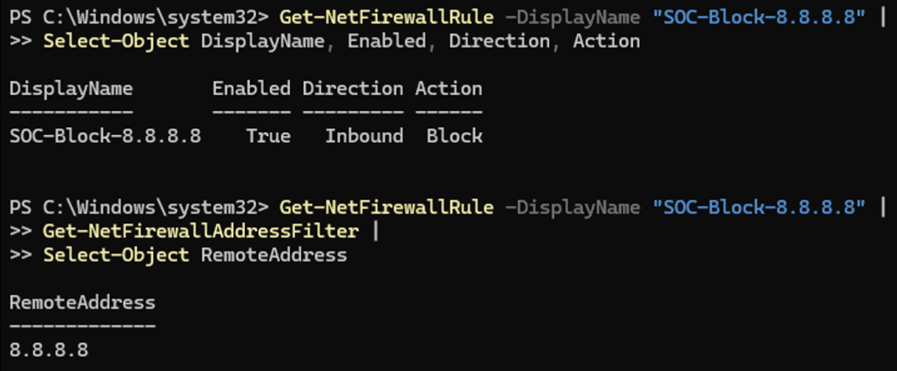
</p>

These are presented as **component-level response validation**. Earlier runbook attempts executed in the wrong context or failed managed-identity/RBAC checks, and the repository does not prove that one uninterrupted Phase 25 incident traversed every step from attack to final containment.

## Testing and Validation

| Test | Result |
|---|---|
| Wazuh Dashboard HTTPS access | Restored after permitting TCP 443 in UFW |
| Windows agent connectivity | Restored after permitting TCP 1514/1515 |
| Domain DNS resolution and join | Verified |
| Wazuh agent health | Verified |
| Windows failed-logon collection | Verified |
| Failed-logon correlation to rule `60204` | Verified |
| Sysmon process telemetry | Verified |
| FIM add/modify/delete events | Verified |
| Windows and Ubuntu CIS SCA | Verified |
| Vulnerability inventory | Verified |
| Wazuh Active Response execution | Verified with non-destructive logging |
| Python alert export | Verified in TXT, JSON, and CSV |
| Shuffle webhook ingestion | Verified |
| VirusTotal and AbuseIPDB enrichment | Verified in Shuffle |
| Slack P1 notification | Verified |
| Human approval WAITING state | Verified |
| Atomic Red Team PowerShell execution | Verified |
| Windows Firewall rule configuration | Component-level verification captured |
| Custom rule `100100` end-to-end trigger | Not verified |
| EICAR event in Wazuh | Not verified; Defender detected it locally |
| One uninterrupted attack-to-containment chain | Not verified |

## Troubleshooting Highlights

### Azure NSG vs. Host Firewall

Services were running and Azure NSG rules were present, but Ubuntu UFW blocked HTTPS and Wazuh agent ports. Testing both cloud and host controls isolated the issue.

### Duplicate Windows EventChannel Configuration

The Windows agent logged a duplicate Security channel warning. Duplicate `<localfile>` configuration was removed and the agent service restarted.

### Indexed Fields vs. Rule Fields

Dashboard fields such as:

```text
data.win.eventdata.image
```

do not use the same naming expected inside Wazuh rule XML. Rule development required decoded fields such as:

```text
win.eventdata.image
```

### Raw Archive Analysis

`logall_json` was temporarily enabled to inspect `archives.json` with `jq` and determine whether Sysmon events were reaching the manager before rule evaluation.

### Connector Limitations

When built-in Shuffle connectors failed or requested unsuitable permissions, direct HTTP actions and webhooks were used instead.

### Response Context and RBAC

A successful runbook message did not automatically prove that a control changed on the intended endpoint. Endpoint-side PowerShell verification and Azure identity/RBAC troubleshooting were required.

## Prerequisites

To reproduce the complete lab, you need:

- Microsoft Azure subscription
- Permission to create resource groups, networking, virtual machines, and Automation resources
- Windows Server 2025 and Windows 11 Pro virtual machines
- Ubuntu Server virtual machine
- Wazuh all-in-one installation or equivalent Manager, Indexer, and Dashboard deployment
- Administrative access to Active Directory and endpoints
- Python 3
- PowerShell
- Sysmon
- Auditd
- Shuffle account
- Optional VirusTotal, AbuseIPDB, Slack, and email credentials
- Atomic Red Team for controlled adversary emulation

Never commit live API keys, webhook URLs, passwords, certificates, or private keys.

## Repository Structure

```text
enterprise-azure-soc-lab/
├── README.md
├── architecture/
│   └── diagrams/
│       ├── active_directory_diagram.md
│       ├── azure_network_diagram.md
│       ├── detection_pipeline.md
│       ├── detection_workflow.md
│       ├── enterprise_soc_architecture.md
│       ├── mitre_mapping.md
│       ├── soar_workflow.md
│       └── wazuh_architecture.md
├── python/
│   ├── lib/
│   │   ├── reporting.py
│   │   ├── threat_intel.py
│   │   ├── utils.py
│   │   └── wazuh.py
│   ├── reports/
│   ├── agent_status.py
│   ├── alert_report.py
│   ├── alert_statistics.py
│   ├── daily_health.py
│   ├── dashboard_export.py
│   ├── incident_report.py
│   ├── ioc_lookup.py
│   ├── log_parser.py
│   ├── soc_health_check.py
│   ├── soc_summary.py
│   └── threat_client.py
└── screenshots/
    ├── 01-azure/
    ├── 02-active-directory/
    ├── 03-windows-client/
    ├── 04-wazuh/
    ├── 05-shuffle/
    ├── 06-python/
    ├── 07-validation/
    └── 08-architecture/
```

## Repository Audit Notes

The repository is evidence-rich, but several improvements would make it stronger and easier to reproduce:

- Remove committed `__pycache__/` directories and `.pyc` files; they are already covered by `.gitignore`.
- Decide whether generated reports are curated evidence or disposable output. Keep a small sanitized sample set and ignore routine generated reports.
- Redact or replace public source IP addresses in reports and screenshots when they are not required for the technical narrative.
- Add sanitized source files for Wazuh rules, agent configuration, Active Response scripts, PowerShell runbooks, Auditd rules, and the Shuffle workflow export.
- Add a license and a concise setup guide.
- Add tests for the Python parsers and replace hard-coded report values with data-derived checks.

## Lessons Learned

1. **Validate at every layer.** Azure networking, host firewalls, services, agents, event channels, rules, and dashboards can each fail independently.
2. **A successful action is not the same as a successful control.** Response actions require endpoint-side verification.
3. **Use safe proof-of-execution first.** Non-destructive Active Response logging allowed the trigger path to be validated before containment.
4. **Treat privileged events carefully.** Event ID `4672` is useful evidence but does not automatically prove malicious escalation.
5. **Separate telemetry generation from alert promotion.** An event may exist locally without being collected, decoded, or promoted into a Wazuh alert.
6. **Human approval matters.** Destructive response actions should pause until an analyst reviews the evidence.
7. **Document gaps honestly.** Troubleshooting outcomes are valuable when the final claim accurately reflects what was and was not proven.

## Future Improvements

- Export sanitized Wazuh configuration, custom rules, decoders, and Active Response scripts
- Export Azure Automation runbooks and the Shuffle workflow as version-controlled code
- Ingest Microsoft Defender Operational events into Wazuh
- Complete end-to-end validation of custom rule `100100`
- Replace prototype status scripts with API- or service-derived checks
- Add unit tests and sample fixtures for Wazuh JSON parsing
- Build dedicated authentication, endpoint-health, threat-intelligence, and response dashboards
- Add standalone email and Microsoft Teams notification paths
- Validate AD account-disable response with a disposable user
- Re-run one controlled incident through the entire attack-to-containment chain
- Add infrastructure as code for repeatable Azure deployment
- Add CI checks for Python syntax, formatting, tests, and secret scanning

## Security and Ethics

All attack activity in this repository was performed in a controlled lab environment for defensive security validation. The project does not provide authorization to test systems that you do not own or have explicit permission to assess.

---

## Author

**Uwais Watkins**  
GitHub: [`waisyrr`](https://github.com/waisyrr)
