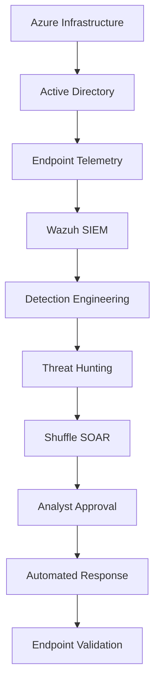

# Enterprise Azure SOC: Wazuh SIEM, SOAR & Incident Response Lab

<p align="left">
  
  
  
  
  
  
  
</p>

> Built a three-system Azure SOC environment integrating Active Directory, Wazuh SIEM, endpoint telemetry, threat hunting, Python reporting, and Shuffle SOAR. The lab processed 482 alerts, correlated authentication attacks, enriched incidents with threat intelligence, enforced analyst approval, and validated response actions on the target endpoint.

<p align="center">
  
</p>

## Key Results

| Outcome | Evidence-backed result |
|---|---|
| Azure environment | 3 virtual machines: Windows Server 2025, Windows 11 Pro, and Ubuntu Server |
| Monitoring coverage | 2 Windows Wazuh agents plus local Ubuntu/Wazuh telemetry |
| Alert processing | 482 alerts exported: 0 Critical, 23 High, 260 Medium, and 199 Low |
| Detection coverage | Authentication, process, SSH, FIM, vulnerability, and CIS monitoring |
| Security findings | 7 vulnerabilities captured: 5 High and 2 Medium |
| Python automation | 1 production-style alert-reporting utility plus 10 supporting lab utilities and prototypes |
| SOAR workflow | 8-stage Shuffle workflow with VirusTotal, AbuseIPDB, Slack, email, and human approval |
| Response validation | Safe Wazuh Active Response proof and component-level Windows Firewall validation |

## Overview

This project models a small enterprise Security Operations Center in Microsoft Azure. It connects Windows and Linux infrastructure to a centralized workflow for log collection, detection, investigation, enrichment, approval, response, and validation.

The repository distinguishes fully validated controls from component-level tests, prototypes, and unresolved telemetry gaps. Successful commands and orchestration jobs are not treated as proof unless the resulting security state was independently verified.

## Skills Demonstrated

| Area | Technologies and capabilities |
|---|---|
| Cloud and networking | Azure VMs, Virtual Network, subnetting, NSGs, static private addressing, UFW, connectivity testing |
| Identity and systems | Active Directory Domain Services, DNS, Group Policy, OUs, users, security groups, Windows Server 2025, Windows 11 |
| SIEM and telemetry | Wazuh Manager, Indexer, Dashboard, Windows Security logs, Sysmon, PowerShell, Auditd, SSH, FIM |
| Detection and investigation | Wazuh rules and decoders, event correlation, MITRE ATT&CK context, threat hunting, Atomic Red Team, CIS SCA, vulnerability review |
| SOAR and response | Shuffle webhooks, conditional routing, VirusTotal, AbuseIPDB, Slack, email, human approval, Wazuh Active Response, Azure Automation |
| Automation and reporting | Python, PowerShell, Bash, JSON, CSV, alert normalization, incident reporting, endpoint-side validation |

## End-to-End SOC Workflow



The lab follows a defensive operations sequence: build the environment, onboard telemetry, detect and investigate activity, enrich the incident, require analyst approval, execute a controlled response, and verify the result on the affected system.

## Architecture

### Azure Infrastructure

<p align="center">
  
</p>

| System | Platform | Role | Private IP |
|---|---|---|---|
| `dc01` | Windows Server 2025 | Active Directory Domain Services, DNS, Group Policy, Wazuh agent | `10.0.0.4` |
| `win11` | Windows 11 Pro | Domain-joined endpoint, Sysmon, PowerShell logging, Wazuh agent | `10.0.0.5` |
| `wazuh01` | Ubuntu Server | Wazuh Manager, Indexer, Dashboard, Linux telemetry, Python tooling | `10.0.0.6` |

The systems reside in the `enterprise-soc-rg` resource group and `enterprise-soc-vnet` (`10.0.0.0/16`). Network Security Groups and host firewalls control management and telemetry traffic.

### Active Directory

<p align="center">
  
</p>

The `enterprise.local` domain contains departmental and resource OUs, role-based security groups, domain users, a domain-joined workstation, and a disposable service account used for response testing.

Implemented controls include password and lockout policies, departmental and privileged groups, Group Policy, DNS-based domain resolution, domain authentication, and least-privilege Remote Desktop access.

<p align="center">
  
</p>

<p align="center"><em>Effective domain password and account-lockout settings verified from Windows.</em></p>

### SIEM and SOAR Integration

<p align="center">
  
</p>

Windows and Linux telemetry is collected by Wazuh, processed through rules and decoders, stored in the Indexer, investigated in the Dashboard, and converted into structured incident data for Shuffle enrichment, notification, approval, and response workflows.

## Implementation

### 1. Azure Infrastructure

The lab uses three Azure virtual machines with static private addressing and internal DNS. Although the Azure NSG rules were configured correctly, the Wazuh Dashboard and agents remained unreachable because Ubuntu UFW blocked the required traffic. I opened the host-firewall ports and verified connectivity from Windows before continuing.

```bash
sudo ufw allow 443/tcp
sudo ufw allow 1514/tcp
sudo ufw allow 1515/tcp
sudo ufw status verbose
```

```powershell
Test-NetConnection 10.0.0.6 -Port 1514
Test-NetConnection 10.0.0.6 -Port 1515
```

### 2. Active Directory and Windows Client

`dc01` was promoted to a domain controller for `enterprise.local`. OUs, users, security groups, password controls, lockout controls, and Group Policy settings were configured before onboarding the Windows 11 endpoint.

After pointing the endpoint to domain DNS, I joined it to `enterprise.local` and validated the result by authenticating with domain user accounts.

<p align="center">
  
</p>

<p align="center"><em>Windows 11 successfully joined to the enterprise domain.</em></p>

### 3. Endpoint and Linux Telemetry

The Windows systems supplied Security events, Sysmon process telemetry, PowerShell activity, File Integrity Monitoring events, and agent-health data. The Ubuntu host supplied SSH authentication logs, Auditd events, local Linux FIM, and Wazuh server logs.

<p align="center">
  
</p>

<p align="center"><em>Centralized visibility for the Windows Server and Windows 11 agents.</em></p>

### 4. Security Monitoring and Posture

#### File Integrity Monitoring

Wazuh captured file-added, file-modified, and file-deleted activity across monitored systems.

<p align="center">
  
</p>

#### Vulnerability Detection

The Windows vulnerability inventory exposed affected packages, CVE identifiers, and severity. The captured validation view showed seven findings: five High and two Medium.

<p align="center">
  
</p>

#### Security Configuration Assessment

Wazuh SCA evaluated CIS benchmark controls for Windows and Ubuntu and displayed passed, failed, and not-applicable checks.

<p align="center">
  
</p>

## Detection Engineering

### Authentication Failure Correlation

Controlled failed-authentication activity generated Windows Event ID `4625` and Wazuh rule `60122`. Repeated events were correlated into rule `60204`, a Level 10 **Multiple Windows Logon Failures** alert associated with brute-force behavior.

<p align="center">
  
</p>

<p align="center"><em>Individual failed logons and the higher-severity correlated alert shown together.</em></p>

A Python timeline reconstructed the progression from the base events to the correlated rule.

<p align="center">
  
</p>

### Detection Coverage

| Activity | Primary evidence | Detection context |
|---|---|---|
| Failed Windows logon | Event ID `4625`, rules `60122` and `60204` | Credential-access and brute-force investigation |
| Successful Windows logon | Event ID `4624`, rule `60106` | Authentication and access review |
| Privileged logon | Event ID `4672`, rule `67028` | Privileged-session investigation |
| Suspicious PowerShell/process activity | Sysmon Event ID `1`, rules including `92021` and `92066` | Command execution and process analysis |
| SSH brute force | Wazuh rule `5712` | MITRE ATT&CK `T1110` |
| File added, changed, or deleted | FIM rules `550`, `553`, and `554` | Integrity monitoring |
| Vulnerable software | Wazuh vulnerability inventory | CVE and package review |
| CIS configuration findings | Wazuh SCA | Security posture and hardening |

### Custom Rule Engineering

I created and loaded custom PowerShell rule `100100`, but it did not trigger as expected. Enabling `logall_json` and inspecting `archives.json` exposed the difference between indexed OpenSearch fields and the decoded fields used by the Wazuh rule engine.

Because the trigger was not proven end to end during the recorded validation window, it is documented as detection-engineering and telemetry-pipeline troubleshooting rather than a successful detection.

## Threat Hunting and Adversary Emulation

### Sysmon Process Investigation

Sysmon Event ID `1` supplied process image, command line, parent process, user context, and hash data. Wazuh surfaced suspicious command-shell, discovery, and PowerShell behavior for analyst review.

<p align="center">
  
</p>

Windows Event ID `4672` was collected as **Special privileges assigned to new logon**. It is treated as privileged-session telemetry, not automatic proof of malicious privilege escalation.

### Atomic Red Team Validation

I installed Atomic Red Team on `win11` and executed PowerShell Command Execution test `T1059.001-17`, which completed with exit code `0`. I then inspected the resulting process image, command line, parent process, identifiers, hashes, and user context in Wazuh Threat Hunting.

<p align="center">
  
</p>

<p align="center"><em>Detailed process telemetry captured after controlled PowerShell adversary emulation.</em></p>

The event is not presented as automatically MITRE-mapped unless that mapping is visible in the Wazuh rule metadata.

## Python Automation

The primary data-driven utility is [`python/alert_report.py`](python/alert_report.py). It:

- Reads Wazuh `/var/ossec/logs/alerts/alerts.json`
- Handles missing files, permission failures, and malformed JSON lines
- Normalizes alert, agent, source-IP, username, and MITRE fields
- Assigns severity from Wazuh rule level
- Aggregates top rules, endpoints, source IPs, and ATT&CK techniques
- Writes TXT, JSON, and CSV reports

```bash
cd python

python3 alert_report.py \
  --input /var/ossec/logs/alerts/alerts.json \
  --output-dir reports \
  --limit 1000
```

<p align="center">
  
</p>

The committed sample report processed **482 alerts**: 0 Critical, 23 High, 260 Medium, and 199 Low.

### Supporting Utilities and Prototypes

| Script | Purpose | Current maturity |
|---|---|---|
| [`alert_report.py`](python/alert_report.py) | Parse and export Wazuh alert records | Dynamic, data-driven |
| [`daily_health.py`](python/daily_health.py) | Count available alerts and write a daily summary | Dynamic alert count |
| [`log_parser.py`](python/log_parser.py) | Extract recent Wazuh log data into a report | Lab utility |
| [`agent_status.py`](python/agent_status.py) | Produce an agent-status report | Static status template |
| [`alert_statistics.py`](python/alert_statistics.py) | Produce a severity-distribution summary | Partially hard-coded sample values |
| [`soc_health_check.py`](python/soc_health_check.py) | Produce a SOC health summary | Alert count plus static status fields |
| [`incident_report.py`](python/incident_report.py) | Generate an incident-report template | Reporting prototype |
| [`dashboard_export.py`](python/dashboard_export.py) | Document expected dashboard coverage | Reporting prototype |
| [`ioc_lookup.py`](python/ioc_lookup.py) | Produce an IOC lookup report | API lookup not configured |
| [`threat_client.py`](python/threat_client.py) | Report threat-intelligence integration readiness | API clients not configured |
| [`soc_summary.py`](python/soc_summary.py) | Produce a consolidated SOC summary | Lab summary utility |

The Python threat-intelligence prototypes are separate from the working VirusTotal and AbuseIPDB enrichment demonstrated inside Shuffle.

## Shuffle SOAR Automation

<p align="center">
  
</p>

The `Enterprise Wazuh SOC Response` workflow receives structured incident JSON through the `Wazuh Alert Ingestion` webhook. The case schema carries severity, priority, endpoint, target account, failed-logon count, source IP, assigned queue, SLA, assessment, and analyst actions.

The workflow implemented:

1. Webhook ingestion and JSON parsing
2. SOC triage and HIGH/P1 routing
3. VirusTotal hash enrichment
4. AbuseIPDB source-IP enrichment
5. Slack and email notification
6. Human approval
7. Azure Automation response experiments
8. Response validation

### Threat-Intelligence Enrichment

<p align="center">
  
</p>

<p align="center"><em>VirusTotal and AbuseIPDB actions executed during incident enrichment.</em></p>

### P1 Notification

<p align="center">
  
</p>

The Slack alert included the case ID, incident ID, severity, priority, endpoint, targeted account, failed-logon count, assigned queue, and SLA.

## Analyst Approval

<p align="center">
  
</p>

<p align="center"><em>The workflow paused in a WAITING state before a potentially destructive response.</em></p>

The approval gate prevents enrichment or notification success from automatically authorizing endpoint containment or account disablement.

## Automated Response and Validation

### Wazuh Active Response

A safe server-side Wazuh Active Response command was attached to rule `60204`. The script wrote timestamped `SAFE_ACTIVE_RESPONSE_TRIGGERED` entries to `active-responses.log`, proving the rule-triggered execution path before containment testing.

<p align="center">
  
</p>

<p align="center"><em>Non-destructive proof that the Wazuh Active Response workflow executed.</em></p>

### Azure Automation

Azure Automation, a Hybrid Runbook Worker, and PowerShell runbooks were used to test endpoint-side response execution. Managed-identity, RBAC, execution-context, and worker-placement limitations were isolated during testing.

<p align="center">
  
</p>

### Endpoint-Side Validation

The final Windows Firewall state was checked directly on the target system. The rule was enabled, configured to block inbound traffic, and scoped to the intended remote address.

<p align="center">
  
</p>

This is presented as **component-level response validation** because the repository does not prove that one uninterrupted incident traversed every stage from attack generation to final containment.

### Validation Matrix

| Test | Result |
|---|---|
| Wazuh Dashboard HTTPS access | Restored after permitting TCP 443 in UFW |
| Windows agent connectivity | Restored after permitting TCP 1514/1515 |
| Domain DNS resolution and join | Verified |
| Wazuh agent health | Verified |
| Failed-logon collection and correlation to rule `60204` | Verified |
| Sysmon process telemetry | Verified |
| FIM add/modify/delete events | Verified |
| Windows and Ubuntu CIS SCA | Verified |
| Vulnerability inventory | Verified |
| Wazuh Active Response execution | Verified with non-destructive logging |
| Python alert export | Verified in TXT, JSON, and CSV |
| Shuffle webhook, enrichment, and P1 notification | Verified |
| Human approval WAITING state | Verified |
| Atomic Red Team PowerShell execution | Verified |
| Windows Firewall rule configuration | Component-level verification captured |
| Custom rule `100100` end-to-end trigger | Not verified |
| EICAR event in Wazuh | Not verified; Defender detected it locally |
| One uninterrupted attack-to-containment chain | Not verified |

## Troubleshooting Highlights

| Problem encountered | Root cause and resolution | What it demonstrated |
|---|---|---|
| Wazuh Dashboard and agents were unreachable despite correct Azure rules | Ubuntu UFW still blocked TCP `443`, `1514`, and `1515`. I opened the ports and verified them with `Test-NetConnection`. | Cloud and host controls must be tested independently. |
| The Windows agent reported a duplicate Security EventChannel warning | Duplicate `<localfile>` entries were removed before restarting the agent service. | Collection health depends on clean endpoint configuration. |
| Custom rule `100100` loaded but did not trigger | `archives.json` showed that the rule engine required decoded fields such as `win.eventdata.image`, not indexed dashboard fields such as `data.win.eventdata.image`. | Indexed fields and decoder fields belong to different pipeline stages. |
| Built-in Shuffle actions failed or requested unsuitable permissions | Unreliable connector steps were replaced with direct HTTP actions and webhooks, then validated through returned execution data. | SOAR workflows should degrade gracefully when connectors are limited. |
| Azure Automation reported success without proving an endpoint change | Execution context, managed identity, RBAC, and Hybrid Worker placement were tested separately; the firewall state was then checked from Windows. | Orchestration status alone does not prove control effectiveness. |
| Defender detected EICAR locally, but no matching Wazuh event was confirmed | The local control worked, but the Defender-to-Wazuh telemetry path was not proven. | Visibility gaps must be documented rather than overstated. |

## Prerequisites

- Microsoft Azure subscription and permission to create networking, VMs, and Automation resources
- Windows Server 2025, Windows 11 Pro, and Ubuntu Server virtual machines
- Wazuh Manager, Indexer, Dashboard, and agents
- Administrative access to Active Directory and endpoints
- Python 3, PowerShell, Bash, Sysmon, and Auditd
- Shuffle account
- Optional VirusTotal, AbuseIPDB, Slack, and email credentials
- Atomic Red Team for controlled adversary emulation

> Never commit live API keys, webhook URLs, passwords, certificates, or private keys.

## Repository Structure

```text
enterprise-azure-soc-lab/
├── README.md
├── architecture/
│   └── diagrams/
├── python/
│   ├── lib/
│   ├── reports/
│   └── 11 SOC automation and reporting scripts
└── screenshots/
    ├── 01-azure/
    ├── 02-active-directory/
    ├── 03-windows-client/
    ├── 04-wazuh/
    ├── 05-shuffle/
    ├── 06-python/
    ├── 07-validation/
    └── 08-architecture/
```

## Lessons Learned

1. **Validate each layer independently.** Azure networking, host firewalls, services, agents, event channels, rules, and dashboards can fail separately.
2. **Verify the target state.** A successful action or orchestration job is not proof that the intended security control changed.
3. **Use safe proof-of-execution first.** Non-destructive logging validated the Active Response path before containment testing.
4. **Separate telemetry from alerting.** An event may exist locally without being collected, decoded, matched, or promoted into an alert.
5. **Require human approval for destructive actions.** Potential containment remained behind analyst review.
6. **Document gaps honestly.** Unsuccessful tests and visibility gaps strengthen the project when claims match the evidence.

## Future Improvements

- Export sanitized Wazuh configuration, custom rules, decoders, Active Response scripts, Azure runbooks, and the Shuffle workflow
- Ingest Microsoft Defender Operational events into Wazuh
- Complete end-to-end validation of custom rule `100100`
- Replace prototype status scripts with API- or service-derived checks
- Add unit tests, sample Wazuh fixtures, CI checks, and secret scanning
- Validate AD account disablement with a disposable user
- Re-run one controlled incident through the complete attack-to-containment chain
- Add infrastructure as code for repeatable Azure deployment

## Security and Ethics

All attack activity was performed in a controlled lab environment for defensive security validation. This project does not authorize testing systems that are not owned or explicitly approved for assessment.

---

## Author

**Uwais Watkins**  
GitHub: [`waisyrr`](https://github.com/waisyrr)
